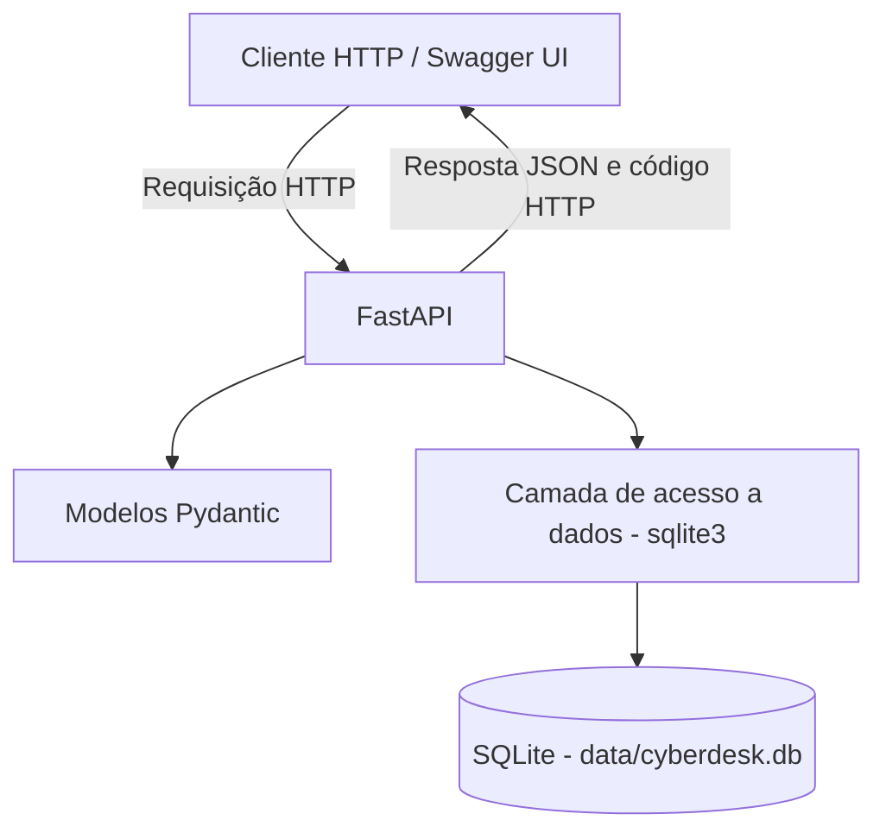

# CyberDesk API

API REST para gerenciamento de incidentes de segurança da informação, desenvolvida com **Python, FastAPI e SQLite** como projeto acadêmico de Cloud Security e DevSecOps.

> **Status:** desenvolvimento local concluído e CRUD validado. **Hospedagem pública ainda não implementada**; a infraestrutura final será definida após a revisão de segurança e a preparação para deploy.

## Visão geral

A CyberDesk API permite cadastrar, consultar, atualizar e excluir incidentes de segurança em um banco relacional SQLite. A aplicação disponibiliza documentação interativa via Swagger UI e utiliza Pydantic para validar as entradas.

### Tecnologias

| Componente | Tecnologia | Finalidade |
|---|---|---|
| Linguagem | Python | Implementação da lógica da aplicação |
| Framework web | FastAPI | Construção dos endpoints REST |
| Validação | Pydantic | Validação e tipagem dos dados de entrada |
| Banco de dados | SQLite (`sqlite3`) | Persistência local dos incidentes |
| Servidor ASGI | Uvicorn | Execução local da API |
| Testes | pytest e TestClient | Testes automatizados dos endpoints |
| Controle de versão | Git/GitHub | Versionamento e documentação |

## Arquitetura



O SQLite é um banco baseado em arquivo, sem servidor de banco de dados separado. O arquivo `data/cyberdesk.db` é criado localmente na inicialização e **não é enviado ao GitHub**.

## Funcionalidades e endpoints

| Método | Rota | Descrição | Resposta de sucesso |
|---|---|---|---|
| `GET` | `/` | Informações básicas da aplicação | `200 OK` |
| `GET` | `/health` | Verificação de disponibilidade | `200 OK` |
| `POST` | `/incidentes` | Cadastro de incidente | `201 Created` |
| `GET` | `/incidentes` | Listagem de incidentes | `200 OK` |
| `GET` | `/incidentes/{incidente_id}` | Consulta por ID | `200 OK` |
| `PUT` | `/incidentes/{incidente_id}` | Atualização completa de incidente | `200 OK` |
| `DELETE` | `/incidentes/{incidente_id}` | Exclusão de incidente | `200 OK` |

**Respostas relevantes:** `404 Not Found` para ID inexistente; `422 Unprocessable Entity` para dados que não atendem às validações. A listagem vazia retorna `200 OK` com `[]`.

## Modelo de dados

Tabela: **`incidentes`**

| Campo | Tipo SQLite | Regra |
|---|---|---|
| `id` | `INTEGER` | Chave primária autoincremental |
| `titulo` | `TEXT` | Obrigatório, entre 3 e 100 caracteres na API |
| `descricao` | `TEXT` | Obrigatório, mínimo de 5 caracteres na API |
| `categoria` | `TEXT` | Obrigatório, entre 3 e 50 caracteres na API |
| `severidade` | `TEXT` | `Baixa`, `Media`, `Alta` ou `Critica` |
| `status` | `TEXT` | `Aberto`, `Em analise` ou `Resolvido`; cadastro começa como `Aberto` |
| `criado_em` | `TEXT` | Data/hora de criação; padrão SQLite `CURRENT_TIMESTAMP` (UTC) |

> As opções de severidade e status são validadas pelos modelos Pydantic da aplicação. O SQLite mantém os tipos e as restrições básicas descritas no esquema.

## Estrutura do projeto

```text
GS - API/
├── app/
│   ├── __init__.py
│   ├── main.py
│   ├── database.py
│   └── models.py
├── data/
│   └── .gitkeep
├── tests/
│   └── test_api.py
├── docs/
│   └── evidencias/
├── .gitignore
├── requirements.txt
└── README.md
```

Os arquivos locais de banco de dados, cache e ambiente virtual não fazem parte do repositório. As evidências devem conter apenas informações adequadas para publicação.

## Pré-requisitos

- Python 3.10 ou superior, em versão compatível com as dependências do `requirements.txt`;
- Git (para clonar o repositório);
- PowerShell ou outro terminal;
- SQLite CLI **opcional**, caso deseje inspecionar o banco manualmente.

## Instalação e execução local (Windows / PowerShell)

1. Clone o repositório quando estiver publicado e entre na pasta:

   ```powershell
   git clone <URL_DO_REPOSITORIO>
   cd <PASTA_CLONADA>
   ```

   Se estiver trabalhando diretamente na pasta local, apenas abra-a no VS Code.

2. Crie e ative um ambiente virtual:

   ```powershell
   python -m venv .venv
   .\.venv\Scripts\Activate.ps1
   ```

3. Instale as dependências:

   ```powershell
   python -m pip install -r requirements.txt
   ```

4. Garanta que a pasta do banco exista e execute a aplicação:

   ```powershell
   New-Item -ItemType Directory -Force data | Out-Null
   python -m uvicorn app.main:app --reload
   ```

5. Acesse:

   - API: <http://127.0.0.1:8000/>
   - Health check: <http://127.0.0.1:8000/health>
   - Swagger UI: <http://127.0.0.1:8000/docs>
   - Especificação OpenAPI: <http://127.0.0.1:8000/openapi.json>

> `--reload` é destinado apenas ao desenvolvimento local. Não deve ser usado na configuração de produção.

## Exemplo de uso

No Swagger UI, abra `POST /incidentes`, selecione **Try it out**, informe o corpo JSON e execute:

```json
{
  "titulo": "Tentativa de Brute Force",
  "descricao": "Multiplas tentativas de login SSH",
  "categoria": "Autenticacao",
  "severidade": "Alta"
}
```

A API deverá responder com **HTTP 201**, um `id` gerado pelo SQLite, `status` inicial `Aberto` e o campo `criado_em`. Em seguida, use `GET /incidentes` para visualizar o registro criado.

Para atualizar um registro com `PUT /incidentes/{incidente_id}`, envie **todos** os campos editáveis, incluindo `status`:

```json
{
  "titulo": "Tentativa de Brute Force",
  "descricao": "Incidente investigado e resolvido",
  "categoria": "Autenticacao",
  "severidade": "Alta",
  "status": "Resolvido"
}
```

## Consultas diretas ao SQLite (opcional)

Na raiz do projeto, com o SQLite CLI instalado:

```powershell
sqlite3 .\data\cyberdesk.db
```

No console SQLite:

```sql
.tables
.schema incidentes
.headers on
.mode column
SELECT id, titulo, severidade, status FROM incidentes;
.quit
```

## Testes automatizados

A suíte utiliza `pytest`, `TestClient` e bancos SQLite temporários para que os testes de escrita não modifiquem o banco local principal.

Execute na raiz do projeto:

```powershell
python -m pytest tests/test_api.py -v
```

**Oito cenários validados no ambiente de desenvolvimento:**

1. Verificação de saúde (`GET /health`);
2. Cadastro de incidente (`POST`);
3. Listagem de incidentes (`GET`);
4. Consulta por ID (`GET`);
5. Atualização (`PUT`);
6. Exclusão (`DELETE`);
7. Tratamento de incidente inexistente (`404`);
8. Rejeição de severidade inválida (`422`) sem gravação no banco.

**Resultado registrado durante o desenvolvimento: 8 testes aprovados.**

## Segurança e limitações

- As consultas SQL utilizam parâmetros (`?`) para não concatenar diretamente os valores recebidos nas instruções.
- Os modelos Pydantic validam os campos de entrada.
- Dados utilizados nas demonstrações são fictícios.
- O arquivo SQLite local, ambientes virtuais e arquivos `.env` são excluídos pelo `.gitignore`.
- **A aplicação ainda não possui autenticação e autorização.** Não deve ser exposta publicamente com operações de escrita sem controles de acesso adicionais.
- SQLite é adequado ao escopo didático e à carga pequena deste projeto; limites de concorrência e estratégias de backup devem ser considerados em uma implantação permanente.
- O uso de HTTPS, logs operacionais, controle de acesso e backups será avaliado antes de publicar a API na internet.

## Evidências e documentação

As capturas de tela produzidas durante o desenvolvimento são organizadas em `docs/evidencias/`. Elas incluem os endpoints no Swagger, a estrutura da tabela no SQLite, as operações do CRUD e a execução do pytest.

A documentação acadêmica final em Word/PDF, com diagramas e explicação da infraestrutura escolhida, será preparada na etapa de entrega. A infraestrutura de nuvem ainda não está provisionada.

## Próximas etapas

- [x] Desenvolver API REST com FastAPI;
- [x] Integrar banco SQLite;
- [x] Implementar e validar CRUD;
- [x] Concluir oito testes automatizados;
- [ ] Publicar o código e a documentação no GitHub;
- [ ] Revisar controles de segurança para exposição externa;
- [ ] Definir e implementar hospedagem (local ou Azure, conforme requisitos acadêmicos);
- [ ] Elaborar relatório técnico final com diagramas e evidências.

## Referências

- [FastAPI — documentação oficial](https://fastapi.tiangolo.com/)
- [Python — módulo sqlite3](https://docs.python.org/3/library/sqlite3.html)
- [SQLite — documentação oficial](https://www.sqlite.org/docs.html)
- [pytest — documentação oficial](https://docs.pytest.org/)
- [Microsoft Azure — documentação oficial](https://learn.microsoft.com/azure/)

---

**CyberDesk API** — Projeto acadêmico de Cloud Security e DevSecOps. Uso educacional e demonstrações com dados sintéticos.
